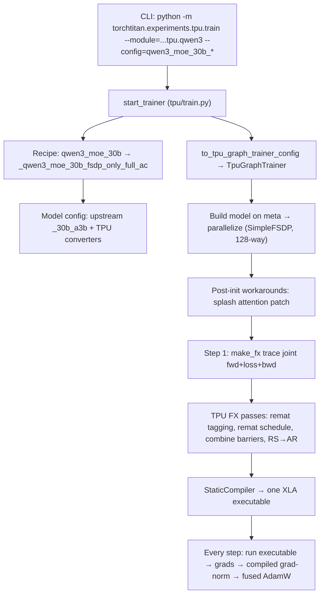

# How Qwen3-30B-A3B MoE trains on TPU: a code trace

Repo: `google-pytorch/torchtitan` @ `b8621caa`. This document follows one training step from the CLI down to the Pallas kernels.

---

## 0. The pipeline at a glance



---

## 1. Entry point and recipe chain

**Entry:** `start_trainer` (`torchtitan/experiments/tpu/train.py L216-457`). Importing `torchtitan.experiments.tpu.qwen3` (train.py:35 (`torchtitan/experiments/tpu/train.py L35`)) registers the recipes.

The recipes build on each other in this order:

| Layer | Function | Adds |
|---|---|---|
| Upstream base | `qwen3_30b_a3b` (`torchtitan/models/qwen3/config_registry.py L323-355`) | AdamW lr 8e-4, C4, FullAC, FSDP |
| Upstream global-aux | `qwen3_30b_a3b_global_aux` (`torchtitan/models/qwen3/config_registry.py L358-370`) | seq 2048, batch-wise aux loss (coeff 1e-3), lr 3e-4, linear decay |
| TPU base | `qwen3_moe_30b` (`torchtitan/experiments/tpu/qwen3/config_registry.py L541-600`) | TPU converters, SimpleFSDP, EP=128, GraphTrainer `aot_fx_trace`, splash attention |
| TPU tuned | `_qwen3_moe_30b_fsdp_only_full_ac` (`torchtitan/experiments/tpu/qwen3/config_registry.py L603-686`) | **EP=1**, ZeRO-2, packed QKV, Pallas GMM, Pallas CE loss, remat schedule, tokamax splash |
| Benchmark | `qwen3_moe_30b_fsdp_only_full_ac_benchmark` (`torchtitan/experiments/tpu/qwen3/config_registry.py L701-708`) | 30 steps, MFU measured from step 10 |
| Profile | `..._profile` (`torchtitan/experiments/tpu/qwen3/config_registry.py L689-698`) | XProf trace on rank 0, step 5 |

> [!IMPORTANT]
> The base `qwen3_moe_30b` uses **EP=128**. The tuned `fsdp_only` recipes use **EP=1**, so every expert runs locally after an FSDP all-gather. The paired W1/W3 Pallas kernel requires EP=1 (grouped_experts.py:195-205 (`torchtitan/experiments/tpu/grouped_experts.py L195-205`)).

### Batch math (tuned recipe)
- Tokens per microbatch per DP rank: `6 * 2048 = 12288` (local batch 6, seq 2048).
- Tokens per step: `768 * 2048 = 1,572,864`.
- On 128 chips: `128 * 12288 = 1,572,864`, so **gradient accumulation = 1**. The recipe is sized for a 128-chip FSDP mesh, matching `fsdp_allreduce_*` comments and "FSDP128" in the docstrings.

---

## 2. Model architecture (what gets built)

Model dimensions come from upstream `_30b_a3b` (`torchtitan/models/qwen3/__init__.py L522-566`):

| Param | Value |
|---|---|
| layers | 48 (all MoE) |
| dim | 2048 |
| heads / kv heads / head_dim | 32 / 4 (GQA) / 128 |
| experts / top-k | 128 / 8, no shared expert |
| expert hidden (F) | 768 |
| vocab | 151936 |
| router | softmax, `route_norm=True` |
| RoPE theta | 1e6 |

Expert parameters per layer: `3 * 128 * 2048 * 768 ≈ 604M`. Across 48 layers that is `≈ 29B`, which accounts for most of the 30B total. About 3B parameters are active per token.

Per-layer config: `_build_qwen3_moe_layers` (`torchtitan/models/qwen3/__init__.py L134-198`). Block forward: `Qwen3TransformerBlock.forward` (`torchtitan/models/qwen3/model.py L54-69`):

```python
x = x + self.attention(self.attention_norm(x), attention_masks, positions, segment_ids)
x = x + self.moe(self.ffn_norm(x))
```

### TPU config rewrites (applied before construction)
In `model_registry` (`torchtitan/experiments/tpu/qwen3/__init__.py L197-231`), `ModelConfigConverter`s rewrite the config tree:

1. `TpuTokenDispatcherConverter` (`torchtitan/experiments/tpu/token_dispatcher.py L286-310`): `AllToAllTokenDispatcher` → `TpuAllToAllTokenDispatcher`
2. `TpuGroupedExpertsConverter` (`torchtitan/experiments/tpu/grouped_experts.py L302-325`): `GroupedExperts` → `TpuGroupedExperts`
3. `TpuPackedQKVConverter` (`torchtitan/experiments/tpu/qkv.py L76`) (tuned recipe only): fused QKV → `TpuPackedQKVLinear`
4. `MaxTextQwen3Config` (`torchtitan/experiments/tpu/qwen3/model.py L18-37`): same model, but FLOPs are counted the MaxText way so MFU numbers can be compared with MaxText.

The tuned recipe then sets expert-kernel options (config_registry.py:620-625 (`torchtitan/experiments/tpu/qwen3/config_registry.py L620-625`)): `use_pallas_grouped_mm`, `use_pallas_paired_grouped_mm`, `tile_m=256`, `tgmm_tiling=(256,0,0)`, `use_kernel_native_weight_layout`.

---

## 3. Trainer selection: why it runs `TpuGraphTrainer`

The recipe sets `use_graph_trainer=True, compile_mode="aot_fx_trace"`, so train.py:232-342 (`torchtitan/experiments/tpu/train.py L232-342`) does three things:

1. Imports the qwen3 graph registry from `graph_trainer/qwen3.py` (`torchtitan/experiments/tpu/graph_trainer/qwen3.py L61-73`).
2. Calls `to_tpu_graph_trainer_config` (`torchtitan/experiments/tpu/graph_trainer/config.py L61`), which wraps `to_graph_trainer_config` (`torchtitan/experiments/graph_trainer/configs.py L256-316`). This replaces only the top-level model class (`TpuGraphTrainerQwen3Model`) and `parallelize_fn`. **All layer configs are kept**, so the TPU dispatcher and expert converters still apply. It also replaces eager AC with graph-based selective AC.
3. Builds `TpuGraphTrainer` (`torchtitan/experiments/tpu/graph_trainer/tpu_graph_trainer.py L90-170`).

> [!NOTE]
> `patched_parallelize` (train.py:384-407 (`torchtitan/experiments/tpu/train.py L384-407`)) is installed on the *original* `model_spec`. The graph-trainer config was already copied, so that wrapper is never called on this path (the comment at L416-419 says so). TPU patches are applied after `__init__` in `_apply_tpu_moe_post_init` (`torchtitan/experiments/tpu/graph_trainer/tpu_graph_trainer.py L717-721`) → `workarounds.apply_patches` (`torchtitan/experiments/tpu/workarounds.py L596-630`). This swaps SDPA for (tokamax) splash attention before the first trace.

---

## 4. Parallelization (SimpleFSDP, 128-way)

Call chain:

```
TpuGraphTrainer.__init__ → GraphTrainer/Trainer.__init__
  → tpu graph_trainer/qwen3.parallelize_qwen3                     (graph_trainer/qwen3.py:39)
      → configure_qwen_simple_fsdp_shard_dims                     (tpu/qwen3/infra/parallelize.py:19)
      → graph_trainer.qwen3.parallelize.parallelize_qwen3
          → annotate_qwen3   (FQN + MoE dispatch/compute/combine region tags)
          → model.parallelize(parallel_dims)  (only if spmd_types / TP / EP)
          → configure_moe_aux_loss_reduction
          → apply_simple_fsdp                                      (all-gather on use, RS on grads)
          → apply_compile
      → holder.build_split_meshes()
```

- `enable_tpu_topo_mesh=True` builds the device mesh from the TPU physical topology.
- `fsdp_reshard_after_forward="never"` gives **ZeRO-2**: parameters are all-gathered once in forward and kept for backward. Only grads and optimizer state stay sharded.
- **Uneven-shard fix:** with 128 experts and FSDP=128, `num_experts % fsdp_degree == 0`, so experts shard on dim 0. If an expert count doesn't divide the degree, `configure_qwen_simple_fsdp_shard_dims` (`torchtitan/experiments/tpu/qwen3/infra/parallelize.py L19-71`) switches to the hidden dim 1 (`_fsdp_shard_dim=1`).
- **Kernel-native layout and sharding:** `TpuGroupedExperts._distribute_states` (`torchtitan/experiments/tpu/grouped_experts.py L185-193`) transposes the sharding specs, because weights are stored as `(E, K, N)` rather than the canonical `(E, out, in)`.

---

## 5. Forward trace of one MoE layer

Input after `ffn_norm` and flattening: `x_TD` with `T = 12288`, `D = 2048`.

### 5.1 `MoE.forward`
moe.py:916-964 (`torchtitan/models/common/moe.py L916-964`)

```python
topk_scores_TK, topk_expert_ids_TK, routing_map_TE = self.router(x_TD, self.expert_bias_E)
num_local_tokens_per_expert_E = routing_map_TE.sum(dim=0)   # (128,)
out_TD = self.routed_experts(x_TD, topk_scores_TK, topk_expert_ids_TK, num_local_tokens_per_expert_E)
```

`expert_bias_E` is `None` here because the global-aux recipe sets `load_balance_coeff=None`.

### 5.2 Router: `TokenChoiceTopKRouter.forward`
moe.py:647-726 (`torchtitan/models/common/moe.py L647-726`)

1. `scores_TE = softmax(gate(x_TD))`. Shape `(12288, 128)`, computed in FP32.
2. `topk` with `k=8, sorted=True`. `sorted=True` is forced for TorchTPU (b/510002414). It is wrapped in `remat.region(..., recompute=False)` so a remat replay reuses the same routing decision.
3. Gather the scores and renormalize: `topk_scores / sum(topk_scores)`.
4. `routing_map_TE`: one-hot boolean via `scatter_`.
5. **Aux loss:** a batch-wise load-balance loss. Its gradient is injected into `topk_scores_TK` in backward through the `carrier` mechanism (moe.py:715-720 (`torchtitan/models/common/moe.py L715-720`)).

### 5.3 `RoutedExperts.forward` = dispatch → experts → combine
moe.py:487-519 (`torchtitan/models/common/moe.py L487-519`)

#### (a) Dispatch: no all-to-all because EP=1
`LocalTokenDispatcher.dispatch` (token_dispatcher.py:108-139 (`torchtitan/models/common/token_dispatcher.py L108-139`)) calls the TPU override `TpuAllToAllTokenDispatcher._local_reorder` (`torchtitan/experiments/tpu/token_dispatcher.py L246-257`) → `local_reorder` (`torchtitan/experiments/tpu/token_dispatcher.py L216-224`):

```python
permutation_N = argsort(expert_ids_TK.reshape(-1), stable=True)   # N = T*K = 98304
# _LocalReorder.forward:
token_indices_N = permutation_N // top_k
routed_x_ND     = index_select(x_TD, 0, token_indices_N)            # expert-major rows
scores_N        = index_select(scores_TK.flatten(), 0, permutation_N)
```

**Why a custom VJP?** (`_LocalReorder` (`torchtitan/experiments/tpu/token_dispatcher.py L154-213`)) Native autograd treats repeated token rows as a collision scatter-add. This version instead inverts the permutation once, gathers the gradient back to token-major order, reshapes it to `(T, K, D)`, and sums over K in FP32. The result is deterministic and avoids the slow TPU scatter.

#### (b) Experts: `TpuGroupedExperts.forward`
grouped_experts.py:228-299 (`torchtitan/experiments/tpu/grouped_experts.py L228-299`)

```python
x_bf16 = x_RD.bfloat16()                                       # R = 98304, D = 2048
gate_RF, up_RF = paired_segment_matmul_pallas_2d(x_bf16, w1_EDF, w3_EDF, group_sizes, tile_m=256, ...)
hidden_RF = F.silu(gate_RF) * up_RF                            # F = 768
out_RD    = segment_matmul_pallas_2d(hidden_RF, w2_EFD, group_sizes, ...)
```

- `group_sizes = num_tokens_per_expert_E` stays an **int32 tensor on the TPU**. Routing can change every step without host sync or recompilation (expert_segment_matmul.py:10-12 (`torchtitan/experiments/tpu/kernels/expert_segment_matmul.py L10-12`)).
- Pallas is used instead of `torch._grouped_mm` because the native mode-2 dWeight is incorrect at `M=4096` (torch_tpu#2668, comment at L233-235).
- The paired kernel loads each routed-token tile once and uses it for both W1 and W3.

#### (c) Kernel layer: JAX Pallas MegaBlox via `torch_tpu`
`expert_segment_matmul.py` (`torchtitan/experiments/tpu/kernels/expert_segment_matmul.py L40-129`)

```python
@pallas.jax_op("tt_experts::grouped_mm")        # torch custom op backed by a JAX function
def _grouped_mm_fwd(lhs, rhs, group_sizes, tile_m, ...):
    return megablox_gmm(lhs, rhs, group_sizes=group_sizes, tiling=...)

# backward:
grad_lhs = megablox_gmm(dout, rhs, transpose_rhs=True)          # dX = dY @ W^T
grad_rhs = megablox_tgmm(lhs.T, dout, preferred_element_type=rhs.dtype)  # dW = X^T @ dY, FP32 accum
_grouped_mm_fwd.register_autograd(_backward, setup_context=_setup_context)
```

`torch_tpu._internal.pallas.jax_op` registers a JAX function as a PyTorch custom op. The FX tracer sees it as one opaque node, and XLA inlines the Pallas Mosaic kernel.

#### (d) Combine
`TpuAllToAllTokenDispatcher.combine` (`torchtitan/experiments/tpu/token_dispatcher.py L259-283`), EP=1 branch:

```python
routed_ND = (routed_RD.float() * scores_N[:, None]).to(bf16)     # or scale_route_weights (fused dScore)
out_TD    = stable_grouped_reduce(routed_ND, token_indices_N, top_k)
#  -> argsort(token_indices, stable) → index_select → reshape (T, 8, D) → FP32 sum over K
```

`_StableGroupedReduce` (`torchtitan/experiments/tpu/token_dispatcher.py L100-142`) replaces upstream's `deterministic_scatter_add` (token_dispatcher.py:156-169 (`torchtitan/models/common/token_dispatcher.py L156-169`)). Its backward is a single row gather. The docstring says this avoids a 768 MiB-per-layer expanded index in the native VJP.

---

## 6. Compilation: one XLA program per step

On the first step, `_make_fx_forward_backward_step` (`torchtitan/experiments/tpu/graph_trainer/tpu_graph_trainer.py L328-417`) runs:

1. **Trace.** `minimal_fx_tracer(make_fwd_bwd_step(model, loss_fn))` captures forward, loss, and backward as one joint FX graph. Outputs are `(loss, *grads)`.
2. **Graph passes.** `construct_tpu_transform_passes` (`torchtitan/experiments/tpu/graph_trainer/tpu_backend_pass.py L519-644`) applies these in order:
   - `remove_parameter_gradient_markers_pass`
   - `tag_with_memory_policy_pass` (policy `"full"` = full activation recompute)
   - `apply_cpu_offload_pass` (no-op unless something is tagged for offload)
   - `selective_activation_remat_pass`
   - `apply_tpu_remat_schedule` (remat_schedule.py (`torchtitan/experiments/tpu/graph_trainer/remat_schedule.py`)), enabled by `enable_graph_trainer_remat_schedule`
   - `apply_combine_barrier_pass` (optimization barriers around the MoE combine)
   - `apply_selected_reduce_scatter_allreduce_pass`: for `wqkv_packed` and `wo` grads of 40 MiB or less, all-reduce + slice instead of reduce-scatter
3. **Lower.** `tpu_backend_compile_pass` (`torchtitan/experiments/tpu/graph_trainer/tpu_backend_pass.py L294-393`) calls `torch_tpu` `StaticCompiler()(gm, example_inputs)` → PJRT/XLA executable. It then rebinds `gm.forward` so later steps run the binary directly, with no per-op Python dispatch.

XLA flags: `xla_enable_hlo_sharding_v3=False` works around a Shardy segfault (config_registry.py:577-580 (`torchtitan/experiments/tpu/qwen3/config_registry.py L574-580`)).

---

## 7. Per-step loop

```
TpuGraphTrainer.train_step                                       (tpu_graph_trainer.py:172)
 └ GraphTrainer.train_step
    ├ forward_backward_step → _make_fx_forward_backward_step      (runs the compiled exe; sets p.grad)
    ├ _clip_grad_norm → CompiledGradNorm (compile_grad_norm=True) (separate small XLA graph)
    ├ optimizer.step()  (AdamW "fused", capturable=True; not in-graph for this recipe)
    └ lr_scheduler.step()
 └ MfuBenchmark.record (benchmark recipe, steps ≥ 10)
```

The loss is `PallasCrossEntropyLoss` (`torchtitan/experiments/tpu/loss.py`) plus the `fused_loss_lm_head` override, which fuses the LM-head matmul with softmax-CE so the `(T, 151936)` logits are never materialized.

---

## 8. TPU-specific deltas vs. upstream GPU path (cheat sheet)

| Concern | Upstream (GPU) | TPU recipe |
|---|---|---|
| Execution | eager / `torch.compile` per block | one traced joint graph → XLA `StaticCompiler` |
| Expert GEMM | `torch._grouped_mm` | Pallas MegaBlox `gmm`/`tgmm`, paired W1/W3 |
| Expert weight layout | `(E, out, in)` | `(E, K, N)` kernel-native, canonical on save/load |
| Dispatch reorder bwd | autograd collision scatter | inverse-permutation gather + FP32 K-sum |
| Combine | `deterministic_scatter_add` | stable sort + reshape `(T, K, D)` + FP32 sum |
| Attention | flex / SDPA | tokamax splash attention (vmap bwd, 1024/2048 tiles) |
| Loss | `ChunkedLossWrapper(CE)` (rejected on TPU) | Pallas fused LM-head CE |
| AC | eager FullAC | graph remat (`memory_policy="full"`) + TPU remat schedule |
| Data parallel | FSDP2 | SimpleFSDP, ZeRO-2, topology-aware mesh |
| Grad comms | reduce-scatter | RS, plus AR+slice for small QKV/`wo` grads |
| MFU FLOPs | `6 * active + attn` | MaxText formula |

---

## 9. Running it (inferred from README pattern)

```bash
# 128-chip slice (e.g. TPU7x), launched per host by your scheduler
python -m torchtitan.experiments.tpu.train \
  --module=torchtitan.experiments.tpu.qwen3 \
  --config=qwen3_moe_30b_fsdp_only_full_ac_benchmark
# fast iteration: --config=qwen3_moe_30b_proxy   (4 layers)
```

Config unit tests: test_tpu_graph_trainer_config.py (`torchtitan/experiments/tpu/graph_trainer/tests/test_tpu_graph_trainer_config.py`).
