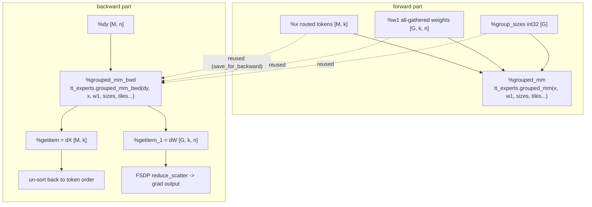
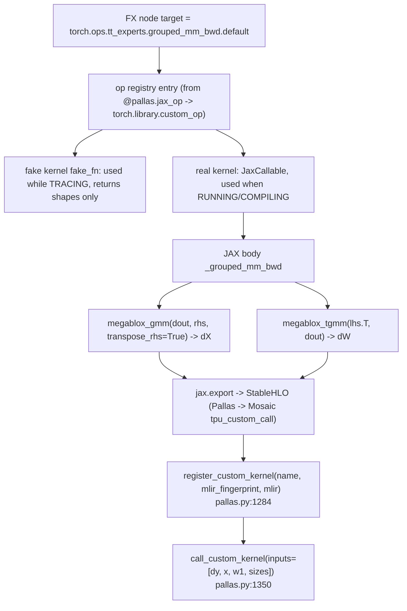
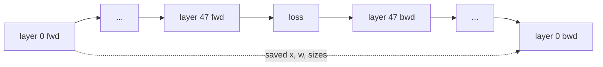
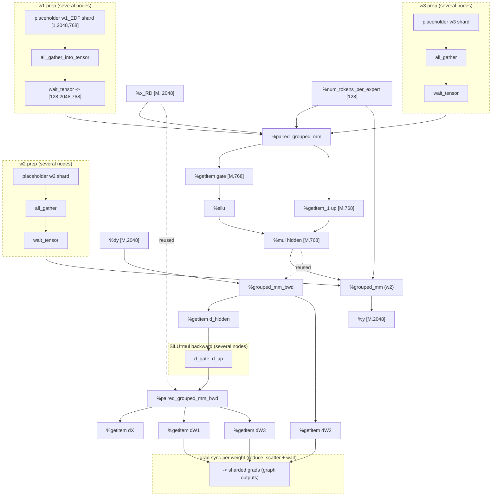
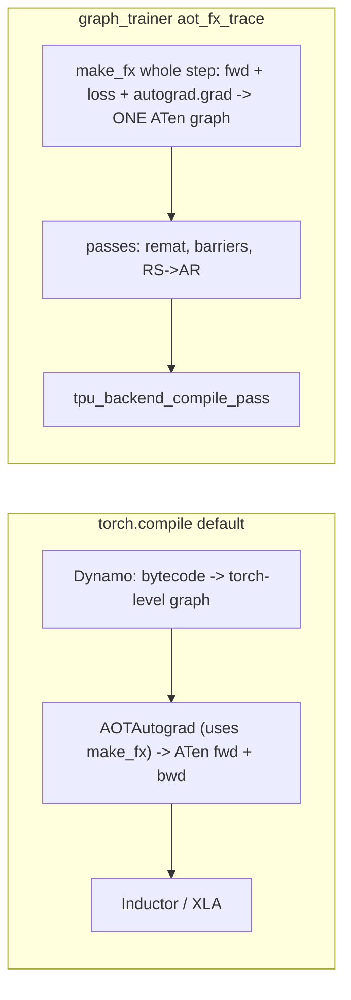
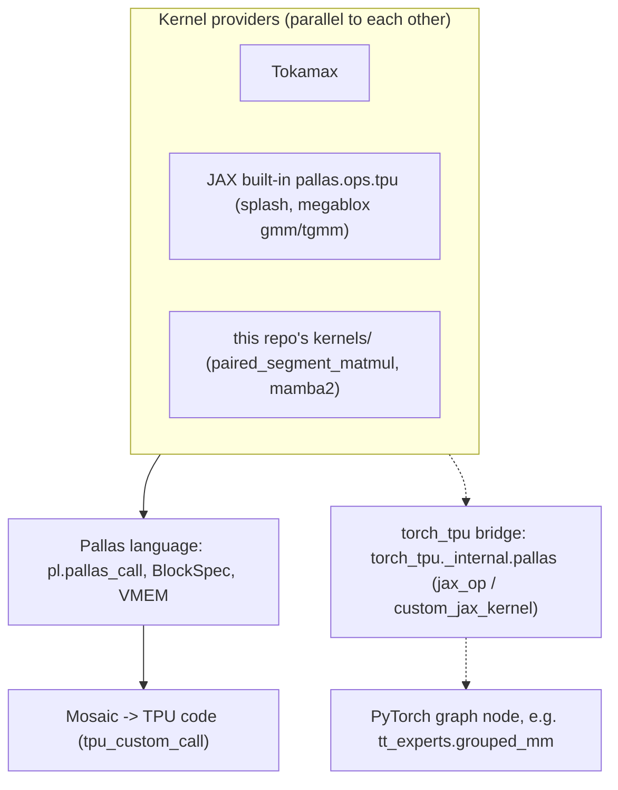
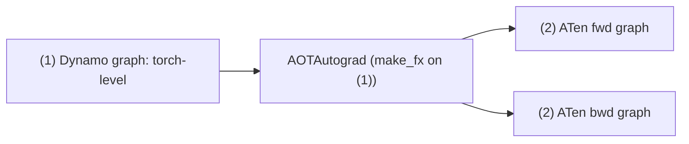
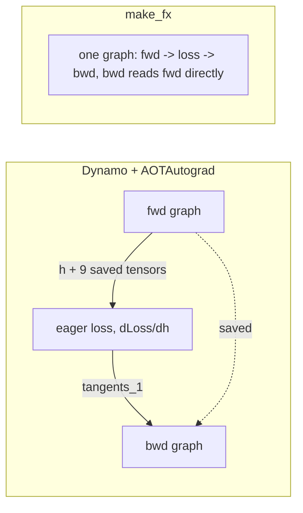

# TorchTitan Graph Trainer on TPU - Custom Ops, Kernels, make_fx vs Dynamo

Running Q&A notes (20 questions) on how custom TPU kernels show up in the
graph_trainer FX graph, what "kernel" means, and why the TPU trainer traces with
`make_fx` instead of Dynamo. Code paths are relative to the torchtitan repo root
unless they start with `torch_tpu/` (local: `~/torch_tpu/src/torch_tpu`).

Demo scripts and logs live in `~/sft/torchtitan/trace_demo/`:
`dynamo_vs_makefx.py`, `dynamo_vs_makefx_output.log`,
`dynamo_vs_makefx_side_by_side.txt`, `dump_nodes_after_pass_output.log`.

## Contents
1. [[#1. What does register_autograd do?]]
2. [[#2. Picture - FX node vs the JAX tt_experts.grouped_mm_bwd kernel]]
3. [[#3. Is that graph only one MoE pass?]]
4. [[#4. Which blocks are real FX nodes? (refined picture)]]
5. [[#5. Is a dashed box one region?]]
6. [[#6. How do you decide what is a node?]]
7. [[#7. What does "kernel" mean? Examples from the codebase]]
8. [[#8. What is Tokamax?]]
9. [[#9. make_fx trace vs Dynamo trace]]
10. [[#10. Is Tokamax a kernel provider in parallel with Pallas?]]
11. [[#11. Does this codebase use Dynamo or make_fx?]]
12. [[#12. Example of a feature that requires make_fx and rejects jit]]
13. [[#13. Can for-loops / if-conditions break make_fx?]]
14. [[#14. Industry - make_fx or Dynamo? Who uses Dynamo and why?]]
15. [[#15. With Dynamo, can we still use graph_trainer?]]
16. [[#16. Does Dynamo generate the same nodes?]]
17. [[#17. When do we need AOTAutograd?]]
18. [[#18. Don't all ops become ATen eventually?]]
19. [[#19. Experiment - Dynamo+AOTAutograd vs minimal_fx_tracer on the toy model]]
20. [[#20. Custom aot_autograd backend with fwd, bwd and loss - same graph as make_fx?]]

---

## 1. What does register_autograd do?

File: `torchtitan/experiments/tpu/kernels/expert_segment_matmul.py` L114-L129.

```python
_grouped_mm_fwd.register_autograd(_backward, setup_context=_setup_context)
```

It is PyTorch's standard `torch.library.CustomOpDef.register_autograd`
(torch_tpu's `_JaxCustomOpDef` only overrides `__call__`). It **teaches autograd
how to differentiate an opaque custom op**. `tt_experts::grouped_mm` calls a
JAX/Pallas kernel, so autograd cannot look inside; without this, `backward()`
would fail and `lhs`/`rhs` would get no gradients.

| Function | When | Job |
|---|---|---|
| `_setup_context(ctx, inputs, output)` | right after forward | save what backward needs |
| `_backward(ctx, grad_output)` | during backward | return one grad per forward input |

```python
def _setup_context(ctx, inputs, output):
    del output                                   # Y not needed: dX = dY @ W.T, dW = X.T @ dY
    lhs, rhs, group_sizes, *static_args = inputs # 3 tensors + 6 tile ints
    ctx.save_for_backward(lhs, rhs, group_sizes)
    ctx.static_args = tuple(static_args)

def _backward(ctx, grad_output):                 # grad_output = dY, shape [M, n]
    lhs, rhs, group_sizes = ctx.saved_tensors
    grad_lhs, grad_rhs = _grouped_mm_bwd(grad_output, lhs, rhs, group_sizes, *ctx.static_args)
    return grad_lhs, grad_rhs, None, None, None, None, None, None, None   # 9 inputs -> 9 grads
```

| Forward input | Returned gradient |
|---|---|
| `lhs` (X) | `grad_lhs` = dX `[M, k]` |
| `rhs` (W) | `grad_rhs` = dW `[G, k, n]` (from `megablox_tgmm`) |
| `group_sizes` | `None` (integers) |
| 6 tile sizes | `None` x 6 |

Symbols: `M` = routed token rows, `k` = input features, `n` = output features,
`G` = number of experts.

Same idea as `torch.autograd.Function` (`forward` / `setup_context` /
`backward`); the `custom_op + register_autograd` style is preferred because it
yields one opaque, `torch.compile`/`make_fx`-safe op.

In the graph trainer: when `minimal_fx_tracer` traces `torch.autograd.grad`,
autograd calls `_backward`, which calls the second custom op. The joint graph
therefore contains a `tt_experts.grouped_mm` node (forward) and a
`tt_experts.grouped_mm_bwd` node (backward, outputs dX and dW).

---

## 2. Picture - FX node vs the JAX tt_experts.grouped_mm_bwd kernel

**A. The node in the traced joint graph (one projection):**



- `save_for_backward` creates **no new nodes**: the backward node just uses the
  same `%x`, `%w1`, `%group_sizes` nodes (so `x` stays alive unless remat).
- Tuple outputs produce `operator.getitem` nodes.
- Tile sizes are Python ints, stored as **constants in the node's args**.

**B. What the node points to underneath:**



| Phase | Who answers the node | Effect |
|---|---|---|
| Tracing | `fake_fn` (`torch_tpu/_internal/pallas/pallas.py` L1650) | no kernel runs; FX records ONE node with fake outputs |
| Run/compile | `JaxCallable.__call__` (L1239-L1357) | JAX body exported to StableHLO, cached by MLIR fingerprint; only tensor args passed |

Takeaways: the FX graph never sees `gmm`/`swapaxes`/`tgmm` separately; static
ints are part of the kernel identity (new tile sizes = new compiled kernel);
`group_sizes` is a runtime tensor so routing changes never recompile; graph
passes treat the op as a black box.

---

## 3. Is that graph only one MoE pass?

Yes - it zoomed into **one MoE layer, one projection**. The real traced graph is
the **whole training step** (fwd of all layers -> loss -> bwd of all layers).

Qwen3-30B: 48 layers, all MoE. Each MoE layer computes:

```
gate = x @ w1 ; up = x @ w3 ; hidden = silu(gate) * up ; y = hidden @ w2
```

With the 30B recipe (`use_pallas_paired_grouped_mm=True`, see
`torchtitan/experiments/tpu/grouped_experts.py` L258-L299):

| Node | Count | Where |
|---|---|---|
| `tt_experts.paired_grouped_mm` (w1+w3 together) | 48 | forward |
| `tt_experts.grouped_mm` (w2) | 48 | forward |
| `tt_experts.paired_grouped_mm_bwd` | 48 | backward, reverse layer order |
| `tt_experts.grouped_mm_bwd` | 48 | backward, reverse layer order |

(So `48 * 2 = 96` forward + 96 backward expert-kernel nodes; an earlier guess of
144 assumed unpaired w1/w3.) Within a layer, w2's backward runs first because
its dX is the `dy` the w1/w3 backward needs.



---

## 4. Which blocks are real FX nodes? (refined picture)

Not every block in the earlier pictures was a node: in the 48-layer picture each
block was a whole layer; "weight prep", "un-sort", "reduce_scatter" were groups.

Legend: **solid box = exactly one FX node**, **dashed box = several nodes collapsed**.



Per MoE layer expert block: 4 custom kernel nodes, 7 `getitem` nodes
(`2 + 2 + 3`), plus a few elementwise nodes. Kernel/getitem nodes follow
directly from the code; dashed-box contents are best reading of the code (verify
by printing the graph).

---

## 5. Is a dashed box one region?

No. The dashed box is only drawing shorthand. A **region** (as graph passes use
it) = all nodes tagged with the **same transformer layer**, parsed from
`node.meta["custom"]["module_fqn"]` (e.g. `layers.7.moe.experts`) by
`_get_layer_id` in `torchtitan/experiments/graph_trainer/common_utils.py`.
Passes like `apply_tpu_remat_schedule` work per region.

The whole picture in Q4 is ONE layer -> every node (solid or dashed) is in
**region 7**, split into forward and backward phases. Gradient reduce-scatters
are tagged with their parameter's region.

| Unit | Size |
|---|---|
| node | one op |
| dashed box | 2-5 nodes (my shorthand) |
| region | ALL nodes of a layer (attn + router + experts, fwd + bwd): hundreds |

---

## 6. How do you decide what is a node?

The tracer decides, mechanically: **make_fx records one node per op call on a
traced tensor**; plain Python leaves no trace.

| Becomes a node | Leaves no node |
|---|---|
| each graph input -> `placeholder` | `nn.Module` calls themselves |
| each ATen op (`aten.mm`, `aten.t`, ...) -> `call_function` | `if`/`for`, int math, shape/dtype checks |
| each custom op -> ONE node (regardless of JAX code inside) | ops returning input unchanged (e.g. `.bfloat16()` on bf16) |
| each element taken from a tuple output -> `getitem` | attribute access (`self.w1`) |
| collectives (`all_gather_into_tensor`, `wait_tensor`) | logging, asserts, annotations (become node **meta**) |
| views too (`aten.t`, `view`) - shown with `bytes=0` | |
| one final `output` node | |

Example from `dump_nodes_after_pass_output.log` (toy `out = x + relu(x @ w1.t()) @ w2.t()`):

```
grad of w2 = dOut.t() @ h  -> #86 t_13 = aten.t(relu_4)        # view node, bytes=0
                              #87 mm_20 = aten.mm(t_13, add_6)  # grad of layers.0.w2
grad of h  = dOut @ w2     -> #88 t_14 = aten.t(w2s_1)
                              #89 mm_21 = aten.mm(...)
```

Authoritative check: `traced.gm.graph.print_tabular()`.

---

## 7. What does "kernel" mean? Examples from the codebase

A **kernel** = a program that runs on the accelerator as one unit of work (one
bar on the XProf TPU timeline). Three usages:

**(1) Hand-written device kernels (Pallas)** in `torchtitan/experiments/tpu/kernels/`.
Example: paired w1/w3 forward, `paired_segment_matmul.py` L87-L162:

```python
def kernel(group_metadata, group_offset, lhs, rhs1, rhs3, out1, out3, acc1, acc3):
    acc1[...] = jnp.zeros_like(acc1)              # FP32 scratch in VMEM
    loaded_lhs = lhs[...]                          # load ONE tile of token rows
    acc1[...] += lax.dot(loaded_lhs, rhs1[...], preferred_element_type=jnp.float32)
    acc3[...] += lax.dot(loaded_lhs, rhs3[...], preferred_element_type=jnp.float32)  # reuse load
    out1[...] = lax.select(mask[...], acc1[...], ...).astype(jnp.bfloat16)

pl.pallas_call(kernel, grid=(1, num_active_tiles, 1),
               in_specs=[lhs_spec, rhs_spec, rhs_spec],
               scratch_shapes=[pltpu.VMEM((tile_m, n), jnp.float32), ...])
```

| Piece | Meaning |
|---|---|
| `kernel(...)` | body; runs once per grid step on one tile |
| `grid` | how many steps |
| `BlockSpec` | which tile to copy HBM (big, slow) -> VMEM (small, fast) per step |
| `pltpu.VMEM` scratch | FP32 accumulator kept on-chip |
| `pl.pallas_call` | turns body + grid into ONE kernel |

Why hand-write: load `x` once for both `x @ w1` and `x @ w3`; ragged per-expert
row counts XLA doesn't handle well.

| File | Kernel |
|---|---|
| `expert_segment_matmul.py` | MoE grouped matmul (MegaBlox gmm/tgmm) |
| `paired_segment_matmul.py` | w1+w3 in one kernel + its dX/dW |
| `splash_attention.py`, `tokamax_splash_attention.py` | blocked attention, no full S x S matrix |
| `linear_softmax_cross_entropy_loss.py` | lm_head + softmax + CE fused (no `[tokens, vocab]` logits in HBM) |
| `mamba2_pallas.py` | Mamba2 scan |

Config knobs like `pallas_grouped_mm_tile_m=256`, `sa_block_q=1024` are kernel
tile sizes.

**(2) Compiler-generated kernels (XLA fusions).** `add`, `silu`, `mul`, `mm`...
are fused by XLA after `tpu_backend_compile_pass`. Many FX nodes -> one kernel
(`fusion.N` in XProf); one custom op node -> possibly several kernels
(`grouped_mm_bwd` = gmm + tgmm, shown as `tpu_custom_call`).

**(3) PyTorch-dispatcher sense:** the implementation registered for an op on a
key: fake kernel (`register_fake`), autograd kernel (`register_autograd`), real
TPU kernel (`custom_op(name, wrapped_fn)`). E.g. "native `torch._grouped_mm`
mode-2 dWeight is incorrect" (`grouped_experts.py` L233) = torch_tpu's built-in
kernel is wrong, so the recipe uses Pallas.

---

## 8. What is Tokamax?

**Tokamax** ([github.com/openxla/tokamax](https://github.com/openxla/tokamax))
is an open-source OpenXLA **library of high-performance kernels**, written in
**JAX + Pallas**, for TPU and NVIDIA GPU: attention (flash, splash, paged), MoE
blocks (grouped matmul, ragged_dot), fused losses, norms, plus autotuning and
benchmarking tools.

In this repo:

| File | Kernel source |
|---|---|
| `kernels/splash_attention.py` | `jax.experimental.pallas.ops.tpu.splash_attention` (older, bundled with JAX) |
| `kernels/tokamax_splash_attention.py` | `tokamax._src.ops.experimental.tpu.splash_attention` |

The 30B recipe selects Tokamax (`config_registry.py` L655-L680):
`use_tokamax_splash_attention_kernel=True`, `use_vmap_bwd=True`,
`sa_q_layout="SEQ_MINOR"`, `sa_block_*` -> fed into `TokamaxConfig`.
`linear_softmax_cross_entropy_loss.py` also imports Tokamax.

Quirk at the top of the file (L15-L38): temporarily replaces
`jaxtyping.jaxtyped` with a pass-through decorator during the Tokamax import -
workaround for openxla/tokamax#240 (typeguard can't parse shape strings like
`"*B T H d"`).

---

## 9. make_fx trace vs Dynamo trace

| | **Dynamo** (`torch.compile` front end) | **make_fx** (`minimal_fx_tracer`) |
|---|---|---|
| How | reads Python **bytecode**, symbolic interpretation | **runs** Python with fake/proxy tensors, records dispatched ops |
| Op level | torch-level (`torch.matmul`, `F.silu`) | ATen (`aten.mm.default`, `aten.silu.default`) |
| Control flow | understood; **guards** + recompile | **baked in**, no guards |
| Unsupported code | **graph break** (several graphs) | must be traceable; always ONE graph |
| Backward | not captured by Dynamo (AOTAutograd later) | captured by tracing `torch.autograd.grad` |
| Reuse safety | guards checked each call | none (`run_traced(_validate_runtime=False)`) |

Example:

```python
def f(x, w, n):
    if n > 2:
        x = x * 2
    return torch.relu(x @ w.t())
f(x, w, n=3)
```

Dynamo: `operator.mul`, `call_method t`, `operator.matmul`, `torch.relu` +
guards (n == 3, shapes, dtypes...). make_fx: `aten.mul.Tensor`, `aten.t.default`,
`aten.mm.default`, `aten.relu.default`; the `if` is gone. Calling with `n=1`:
Dynamo recompiles; make_fx graph silently still multiplies by 2.



Why the TPU trainer uses make_fx: one graph for the whole step (incl.
collectives, no breaks); ATen level is what passes match; the step is static so
no-guards is acceptable (batches always padded to 12288 tokens).

---

## 10. Is Tokamax a kernel provider in parallel with Pallas?

Provider: yes. Parallel to Pallas: no - **Pallas is the language, Tokamax is a
library written in it** (like CUDA/Triton vs FlashAttention).



Watch the name "pallas":

| Import | What |
|---|---|
| `from jax.experimental import pallas as pl` | the kernel **language** |
| `from torch_tpu._internal import pallas` | torch_tpu's **bridge** that wraps any JAX fn as a PyTorch custom op |

---

## 11. Does this codebase use Dynamo or make_fx?

The Qwen3-30B TPU path uses **make_fx**. The switch is
`torchtitan/experiments/graph_trainer/configs.py` L69-L75:

```python
mode: Literal["jit", "aot_fx_trace"] | None = "aot_fx_trace"
#   aot_fx_trace: non-strict tracing of fwd+loss+bwd via make_fx
#   jit: standard torch.compile() with custom backend (deprecated)
```

The recipe sets `compile_mode="aot_fx_trace"`; `graph_trainer/trainer.py` L184
takes the make_fx path unless PP is on or mode != `aot_fx_trace`. AutoParallel,
Graph PP and precompile require make_fx. Dynamo still appears in `jit` mode,
upstream's regular trainer (`torch.compile` per block), and custom ops register
fake kernels so they work under both.

---

## 12. Example of a feature that requires make_fx and rejects jit

**AutoParallel** (`configs.py` L199-L206):

```python
if compile_config.enable_autoparallel and compile_config.mode != "aot_fx_trace":
    raise ValueError("AutoParallel graph_trainer integration only supports --compile.mode aot_fx_trace")
```

AutoParallel picks a sharding per op via an ILP:
`minimize compute_time + comm_time subject to memory_per_chip <= HBM`, over a
placement (Shard/Replicate) per node.

| Needs | make_fx | Dynamo |
|---|---|---|
| every op at ATen level | yes | no (torch-level) |
| fwd + bwd in one graph | yes (joint) | no (fwd only) |
| one complete graph | always | graph breaks split it |

`autoparallel_api.py` L94-L98 compiles `self.joint_with_descriptors` (the joint
graph) with `aot_compile_joint_with_descriptors`.

Second example: **Graph PP** (`graph_pp/pipeline.py` L45-L46,
`"GraphPP requires --compile.mode aot_fx_trace"`): each stage is a traced graph
whose fwd/bwd the runtime schedules separately (Interleaved1F1B, ZBVZeroBubble,
DualPipeV).

Common thread: anything that must see or rearrange backward / the whole step at
ATen level needs make_fx (also the TPU remat, barrier, RS->AR passes).

---

## 13. Can for-loops / if-conditions break make_fx?

Only some. It depends on what the condition depends on:

| Depends on | make_fx does | Safe? |
|---|---|---|
| A: Python values constant across steps (config, #layers, fixed shapes) | runs once, bakes in; loops unrolled | yes (common) |
| B: Python values that change per step (step number, last microbatch, varying shape) | bakes in trace-time value, no guard | **silently wrong** |
| C: tensor values (`if x.sum() > 0`, `.item()`, `range(int(t))`) | fake tensors have no values -> error | fails loudly |

```python
for layer in self.layers: h = layer(h)        # A: unrolled into 48 copies
if step_num < 100: x = x * 0.1                # B: traced at step 1 -> always 0.1
n = int(sizes[e])                             # C: data-dependent error
```

How the codebase avoids them:

| Risk | Mitigation | Where |
|---|---|---|
| C: per-expert counts | `group_sizes` stays a TPU tensor; ragged loop inside the kernel | `expert_segment_matmul.py` L11-L12, L142 |
| B: varying batch shape | collator always pads to 12288 tokens, labels -100 | `components/data/collators.py` L69-L111 |
| B/C: valid-token count | passed as device tensor `global_valid_tokens` | `trainer.py` L932-L947 |
| B: grad accumulation / HSDP last microbatch | decided outside the traced fn | `trainer.py` L953-L995 |
| side effects | outside trace (`ntokens_seen`); routing metrics as graph outputs | `graph_trainer/trainer.py` L96-L125, L202 |

Rules: loops/ifs over config are fine; per-step values -> tensor inputs or
decide outside; never read tensor values in Python; keep shapes fixed; new
config -> new trace (trainer traces once: `if self._traced_step is None`).

---

## 14. Industry - make_fx or Dynamo? Who uses Dynamo and why?

- In PyTorch land, **Dynamo (`torch.compile`) is far more popular** for users.
- **make_fx is mostly an internal building block** (inside AOTAutograd and
  `torch.export`); whole-step make_fx tracing is specialized (graph_trainer).
- The make_fx *style* (trace by execution, bake control flow) is mainstream via
  **JAX `jax.jit`** (MaxText, T5X, Pax).

| Uses Dynamo | How |
|---|---|
| HF Transformers / Accelerate | `torch_compile=True` / `torch.compile(model)` |
| PyTorch Lightning | `torch.compile(model)` before `fit` |
| torchtune | compiles each transformer layer |
| upstream torchtitan regular trainer | per-block `torch.compile` |
| vLLM / SGLang | forward through Dynamo with custom backend + CUDA graphs |
| DeepSpeed | optional integration |

Why Dynamo: works on almost any Python (graph breaks fall back); guards keep it
correct; opt-in/incremental; free Inductor speedups on GPU; official path.

Why make_fx anyway: one whole-step graph (fwd + bwd + collectives); rearranging
backward/communication (remat, RS->AR, AutoParallel, Graph PP); static AOT
compilation for TPU/XLA-like backends.

---

## 15. With Dynamo, can we still use graph_trainer?

Partly. graph_trainer has a deprecated Dynamo mode `compile.mode="jit"`
(`graph_trainer/compile.py` L38-L53): `model.compile(backend=..., fullgraph=True)`
with a FutureWarning.

| | `jit` (Dynamo) | `aot_fx_trace` (make_fx) |
|---|---|---|
| Captured | `model.forward` only | fwd + loss + bwd |
| Graphs | fwd and bwd separately | one joint graph |
| Passes | at most one: `auto_bucketing` or `transformer_block_bucketing` (`jit_backend.py` L34-L44) | full registry incl. TPU pipeline |
| AutoParallel / Graph PP / precompile | rejected | yes |
| Status | deprecated | default |

For the TPU trainer, `jit` falls back to the base trainer
(`graph_trainer/trainer.py` L184-L188), so `_make_fx_forward_backward_step` and
all TPU passes (remat schedule, combine barrier, RS->AR, `tpu_backend_compile_pass`)
never run.

---

## 16. Does Dynamo generate the same nodes?

Depends on which graph:



- Graph (1): **no**, torch-level.
- Graph (2): **mostly the same ATen ops**; custom ops identical.

Remaining differences vs make_fx: scope (model only, no loss), two graphs with a
partitioner-chosen saved-tensor boundary, functionalization of in-place ops,
different metadata producer, different placeholder convention
(`primals_*`/`tangents_*` vs `run_traced`'s `[state..., meshes, user inputs]`).

---

## 17. When do we need AOTAutograd?

Usually you don't turn it on yourself; the **backend decides**:

| `torch.compile(backend=...)` | Dynamo | AOTAutograd | Then | Use |
|---|---|---|---|---|
| `"eager"` | yes | no | run torch-level graph | debug Dynamo |
| `"aot_eager"` | yes | yes | run ATen graphs as-is | debug AOT / base for custom passes (graph_trainer default backend, `configs.py` L77) |
| `"inductor"` (default) | yes | yes | Triton/C++ codegen | normal speedups |
| `aot_autograd(fw_compiler=..., bw_compiler=...)` | yes | yes | your function gets ATen graphs | custom passes |

Add it explicitly only for a **custom backend that needs ATen graphs,
especially backward** - exactly graph_trainer's jit mode (`jit_backend.py`
L55-L65):

```python
backend = aot_autograd_backend(fw_compiler=autobucketing_reordering_pass,
                               bw_compiler=autobucketing_reordering_pass)
model.compile(backend=backend, fullgraph=True)
```

Without it, a custom backend gets only the torch-level forward graph (no
backward, so no gradient `reduce_scatter`s to bucket).

What AOTAutograd adds: backward graph, ATen ops (+ decompositions),
functionalization, fwd/bwd partitioning (save vs recompute). graph_trainer's
make_fx path does the first two itself and handles remat with its own passes.

---

## 18. Don't all ops become ATen eventually?

At **run time**, yes - every op dispatches to ATen kernels. The difference is
whether those ATen calls are **recorded into a graph ahead of time**.

| | Dynamo only | Dynamo + AOTAutograd |
|---|---|---|
| In the graph | `torch.matmul`, `F.silu` | `aten.mm`, `aten.silu` |
| On device | ATen (dispatcher converts at run time, not recorded) | ATen (already listed) |
| Backward | not in any graph; autograd runs it eagerly | own ATen graph |

One torch-level call can become different ATen ops:

| torch-level | ATen |
|---|---|
| `torch.matmul(x, w.t())` 2-D | `aten.t` + `aten.mm` |
| `torch.matmul` 3-D | `aten.bmm` or `view` + `mm` + `view` |
| `F.linear(x, w, b)` | `aten.t` + `aten.addmm` |
| `(x @ w).backward()` | two more `aten.mm` + `aten.t` |

Graph passes that match/move/remove specific ops (FSDP bucketing in
`fsdp_passes.py`, RS->AR, remat) need the ATen nodes - and the backward - to
exist in the graph.

---

## 19. Experiment - Dynamo+AOTAutograd vs minimal_fx_tracer on the toy model

Script: `trace_demo/dynamo_vs_makefx.py`. Path A = the real
`minimal_fx_tracer` + `run_traced`; path B = `torch.compile` with Dynamo ->
`aot_autograd(fw, bw)`. Model: residual MLP, 2 layers,
`h_next = h + relu(h @ W1) @ W2`, `loss = sum((h - t)^2) / n`, `x (8,16)`,
`W1 (16,64)`, `W2 (64,16)`. (VM TPU failed to start with `START_SESSION
failed`, so it ran on the VM CPU; graphs are device-independent.)

| Graph | Nodes | Ops | Contents |
|---|---|---|---|
| B-1 Dynamo | 14 | 8 | torch-level fwd: `operator.matmul` x4, `torch.relu` x2, `operator.add` x2 |
| B-2 AOT forward | 16 | 10 | ATen fwd |
| B-3 AOT backward | 30 | 19 | ATen bwd |
| A make_fx joint | 47 | 39 | ATen fwd + **loss** + bwd |

**Same ATen ops, node for node:** make_fx #7-#16 = AOT fwd #5-#14
(`mm, relu, detach, mm, add` x2); make_fx #27-#45 = AOT bwd #10-#28
(`t, mm, t, mm, detach, threshold_backward, ...`). make_fx has 10 extra loss
nodes:

```
loss fwd: #17 sub = h - t   #18 pow_1 = sub^2   #19 sum_1   #20 div = sum_1 / n
loss bwd: #21 ones_like = 1 #22 div_1 = 1/n     #23 expand (8,16)
          #24 pow_2 = sub^1 #25 mul = 2*sub     #26 mul_1 = expand * mul  = 2*(h - t)/n = dLoss/dh
```

In path B those ran eagerly; the result entered the AOT bwd graph as
`tangents_1` (make_fx #28 `mm(t, mul_1)` == AOT bwd #11 `mm(t, tangents_1)`).

**Boundary:** AOT fwd returns 10 values = `h` + 9 saved tensors (4 weights, x,
relu, detach, add, relu_1, detach_1); AOT bwd takes those 9 + `tangents_1`.
make_fx has no boundary (bwd `#38 t_4 = t(relu)` reads fwd `#8 relu`
directly) -> remat passes can still rewrite what is kept alive; in AOT the
partitioner already froze it.



**Placeholders:** Dynamo `l_self_modules_layers_modules_0_parameters_w1_`,
`l_x_`...; AOT `primals_*`, `tangents_1`; make_fx `arg0_1..arg6_1` = 4 weights,
x, t, n (`run_traced` order).

**Metadata (notable):**

| Graph | op nodes with `module_fqn` | bwd nodes with `autograd_backward` |
|---|---|---|
| AOT fw | 10/10 | n/a |
| AOT bw | 18/19 | 19/19 |
| make_fx | 10/39 (fwd only) | 0; all bwd nodes `seq=11` |

On this VM's torch_tpu wheel, make_fx loses backward metadata because
`torch.compiler._patch_engine_backward` is missing, so backward nodes inherit
the last forward `seq_nr` and `_copy_fwd_metadata_to_bw_nodes` can't map them.
AOTAutograd does its own seq_nr bookkeeping.

**Numerics:** loss `34.395226` both; max |diff| over loss + 4 grads `0.000e+00`.

| Question | Answer |
|---|---|
| Dynamo alone gives ATen? | No |
| Dynamo + AOT same ATen ops as make_fx? | Yes, op for op, for the model part |
| make_fx extras? | loss fwd/bwd (10 nodes), `ones_like` start of bwd |
| Biggest difference? | AOT: 2 graphs + frozen saved-tensor boundary; make_fx: 1 graph |

---

## 20. Custom aot_autograd backend with fwd, bwd and loss - same graph as make_fx?

Not quite, and graph_trainer couldn't use it as-is.

1. `aot_autograd` has no "loss" slot (it takes `fw_compiler`, `bw_compiler`,
   `partition_fn`, `decompositions`...). Include the loss by compiling a function
   that computes it:

```python
step = torch.compile(lambda x, t, n: loss_fn(model(x), t, n), backend=backend, fullgraph=True)
loss = step(x, t, n); loss.backward()
```

2. A joint graph exists briefly inside a custom `partition_fn`, but it must
   return two graphs:

```python
def my_partition(joint_gm, joint_inputs, *, num_fwd_outputs, **kw):
    CAP["joint"] = joint_gm            # closest to the make_fx joint graph
    return default_partition(joint_gm, joint_inputs, num_fwd_outputs=num_fwd_outputs, **kw)
backend = aot_autograd(fw_compiler=fw, bw_compiler=bw, partition_fn=my_partition)
```

| graph_trainer expects | Dynamo + AOT (loss + partition_fn) |
|---|---|
| ONE executed graph (one TPU program) | joint only inside partition_fn; two executables with saved-tensor boundary |
| bwd seed `ones_like(loss)` in graph | seed is a `tangents` input from `loss.backward()` |
| outputs `[loss, *grads]` | fwd outputs + grads of every primal (None for non-params) |
| inputs `[state by state_fqns, meshes, user inputs]` + `TracedResult` for `run_traced` | `primals_*`/`tangents_*`, no TracedResult |
| `parameter_gradient_fqns` tags | not produced |
| `module_fqn` + `autograd_backward` | yes |
| no guards / breaks | guards + recompiles; `fullgraph=True` errors on breaks |

Why the split breaks TPU passes: `apply_tpu_remat_schedule` inserts
`optimization_barrier(x_1, add_6, mm_16, mm_18)` tying a forward value to a
backward value; after partitioning they live in different graphs. Same for
remat (save set frozen), RS->AR (needs gradient/param tags) and
`tpu_backend_compile_pass` (one executable for the step).

Options:
1. That is essentially graph_trainer's deprecated `jit` mode (`jit_backend.py` L55-L65).
2. AOTAutograd's joint API without Dynamo - AutoParallel uses
   `aot_compile_joint_with_descriptors` (`autoparallel_api.py` L94-L98).
3. Keep `aot_fx_trace` (make_fx) - the only path giving one executable joint
   graph with the metadata and `run_traced` contract the passes rely on.
